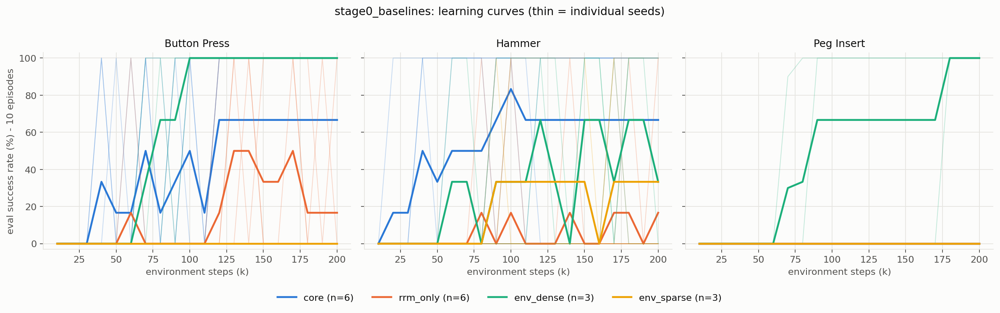
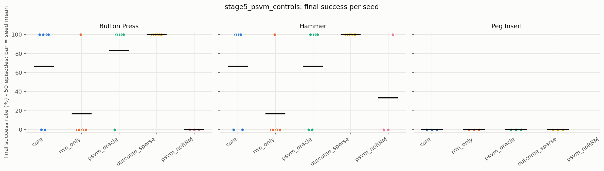
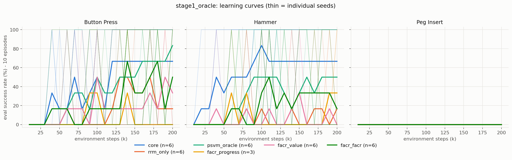
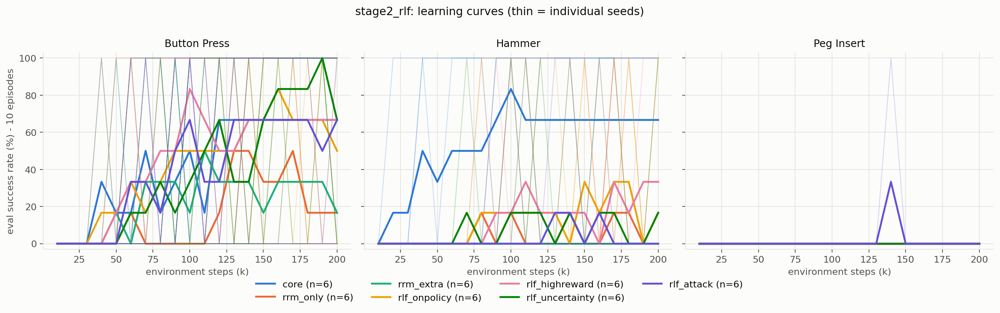

# CoRe extensions: P-SVM, FACR and Reward-Learning-through-Falsification (RLF) - feasibility study

*Autonomous execution report. Generated 2026-10-23 from the raw run data in this repository / Hugging Face dataset (links and commit/revision in `TRANSFER_AND_CLEANUP_MANIFEST.md`).*

## Section 1 - Executive summary

**What was tested.** Three hypotheses for replacing / strengthening CoRe's LLM-written formal reward (FRM): **A) P-SVM** (a success-vs-failure visitation discriminator, with probabilistic outcome labels), **B) FACR** (a learned success-value plus learned-dynamics counterfactual advantage), **C) RLF** (an attack policy / selectors that find reward-model failures, verified and used to repair the learned reward). All were built on a port of the official CoRe code (commit `d663cab`) with the released FRM files, on MetaWorld Button Press, Hammer and Peg Insert (plus Dial Turn for key arms), 200k environment steps per run.

**What completed.** 255 training runs (3-6 seeds per cell; 21 of them are the archived first attempt of the RLF arms described in Section 5), the A1 oracle feasibility tests for P-SVM and its controls, B1/B2/B4 FACR diagnostics against simulator-branching ground truth, A2 label-corruption experiments on fixed trajectories, and C1/C2/C3/C5/C6 for RLF. **Not run** (no VLM/API access was authorised, see Section 11): A3 real-VLM outcome labels, B5 non-oracle FACR, C4 noisy/VLM verifiers, the VLM-labelled P-SVM and non-oracle FACR rows, and the tasks Sweep Into, Drawer Open and Soccer. Important deviation: the RRM's preference labels come from a noisy scripted teacher on the environment reward, not a VLM, so the CoRe numbers here are **not** an exact reproduction (Section 2).

**Main findings.**
1. **P-SVM (oracle labels) passes the provisional gap-closure screen** (G = 1.33 on Button Press, 1.00 on Hammer, observed baselines; Peg Insert undefined because CoRe and RRM-only are both 0%) **but the screen is misleading**: the control "RRM + plain sparse success reward" (`outcome_sparse`) reaches **100% on both tasks (6 seeds)**, better than oracle P-SVM (83% / 67%) and full CoRe (67% / 67%). The gain over RRM-only comes from the *oracle success flag*, not from the visitation-matching mechanism; SVM alone without RRM is weak (0% / 33%).
2. **FACR does not show a distinct useful mechanism.** The success value V(s,h) is learned well (AUC 0.95-0.98, ECE 0.01-0.04 with plentiful positives, and it tracks real success probability better than the FRM's geometric proximity at state level), but the counterfactual action advantage correlates only weakly with simulator-branching ground truth (within-state Spearman 0.03-0.31; ~equal with perfect simulator dynamics) and the policy-learning arm is no better than simpler value/progress shaping or RRM-only at 1.3x wall-clock cost.
3. **RLF: verified-counterexample repair with cheap selectors (uncertainty, high-reward) improved Button Press over the matched label-budget control (66.7% vs 16.7%), but the falsification (attack) policy gave no benefit over those cheap selectors** while costing +45% environment steps. It finds failure regions that are different from on-policy ones (75% of its confirmed-failure cells unvisited by the task policy), but a random policy does too (70%), and it confirms fewer failures per verification query than high-reward or uncertainty selection.
4. Everything is **statistically weak**: outcomes are almost always 0% or 100% per seed, so 6 seeds give 95% bootstrap intervals of roughly +-50 points. Peg Insert is 0% for every learned reward arm.

**Recommendation: NONE of the three, as framed.** P-SVM's mechanism is not supported by the control (and its novelty is "incremental"); FACR is rejected on evidence and on novelty; the RLF *attack policy* is rejected, although the weaker statement "verified counterexamples with simple selection help the RRM" is supported by one task. The most evidence-based follow-up is not one of the three ideas but the thing the control exposed: **RRM + an outcome signal is very strong, so the open question is how reliable the outcome labels are** (A2 shows probabilistic weighting only helps for independent label noise, and hurts under correlated errors). That follow-up would need the real-VLM experiments that were not possible here. Confidence in the negative conclusions: moderate; confidence in any positive generalisation: low.

## Section 2 - Reproduction of CoRe

**Setup.** Python 3.9 venv (`uv`), torch 1.13.1+cu117, mujoco 3.1.1, the MetaWorld copy bundled with CoRe, headless EGL rendering; 8x A100-80GB shared by up to 66 concurrent runs. Upstream: https://github.com/nihx9919/CoRe, commit `d663cabc38e6d6f39ac5e1e4327d94f17f84fa59` (2026-06-15); no upstream file was modified. The training loop was ported to `src/common/core_train.py` (no hydra, no LLM client). Hyper-parameters are `configs/common.yaml` (CoRe's `run_meta.sh` values: segment 20, RRM batch 20, max feedback 500, 19k pre-steps, alpha 0.5, SAC batch 512, lr 3e-4, ...).

**Deviations (uniform across arms).** (i) *No VLM*: preference labels come from a scripted teacher on the privileged environment reward with 15% symmetric label noise (`src/common/rrm_scripted.py`); the VLM frame-importance KL term is off. (ii) FRM = the released final FRM, static (no online LLM refinement). (iii) 200k steps instead of 500k; RRM images 128x128 instead of 300x300. (iv) separate evaluation env; final evaluation = 50 episodes per seed. (v) State-based modules (39-d observation, goal hidden), not pixels.

**Verified published figures.** Table 2 of the CoRe paper (arXiv 2607.01721) reports RRM-only vs CoRe: Sweep Into 94.0 -> 97.3, Button Press 8.7 -> 100, Dial Turn 36.0 -> 98.0, Hammer 49.3 -> 98.0, Peg Insert 36.0 -> 100 (matches the figures quoted in the assignment). Qualification: each value is from **three seeds** and a 500k-step budget with online FRM refinement and a Gemini-based RRM; Table 1 shows Peg Insert env-sparse 0.0, and the paper itself notes Hammer's 66.7% sparse result reflects reward hacking.

| Task | CoRe published | CoRe reproduced (this study) | RRM-only published | RRM-only (sim. teacher) | Env sparse publ. | Env sparse repr. | Env dense publ. | Env dense repr. |
|---|---|---|---|---|---|---|---|---|
| Button Press | 100.0 | 66.7 ± 51.6 (n=6) | 8.7 | 16.7 ± 40.8 (n=6) | 66.7 | 0.0 ± 0.0 (n=3) | 100.0 | 100.0 ± 0.0 (n=3) |
| Hammer | 98.0 | 66.7 ± 51.6 (n=6) | 49.3 | 16.7 ± 40.8 (n=6) | 60.7 | 66.7 ± 57.7 (n=3) | 97.3 | 66.7 ± 57.7 (n=3) |
| Peg Insert | 100.0 | 0.0 ± 0.0 (n=3) | 36.0 | 0.0 ± 0.0 (n=3) | 0.0 | 0.0 ± 0.0 (n=3) | 100.0 | 100.0 ± 0.0 (n=3) |

*Table 2.1 - published vs reproduced final success rate (%), mean ± sd over seeds (final 50-episode evals). Published values are from the paper (3 seeds); "reproduced" are independent retrainings here.*

**Reproduction discrepancies (not hidden).** Environment baselines reproduce (dense: 100/67/100 vs published 100/97/100 with one failed Hammer seed; sparse 0/67/0 vs 67/61/0). **Full CoRe reproduces only partially**: 67% on Button Press and Hammer (6 seeds; bimodal per seed), **0% on Peg Insert and 0% on Dial Turn** where the paper reports 100% and 98%. Likely causes (untested): 200k vs 500k steps, no online FRM refinement, our simulated-teacher RRM, 128-px images, 3-6 instead of paper seeds. Also noted: upstream's replay relabelling re-applies the (1-alpha) weight to FRM rewards stored already weighted at collection time (effective FRM weight 0.25 on those samples), which our port keeps for `core` but our learned-reward arms do not. All gap-closure numbers below use **our observed baselines**, as required.

## Section 3 - P-SVM-CoRe experiments (Idea A)

**Implemented algorithm** (`src/psvm/psvm_ext.py`). Following the SVM paper (arXiv 2606.23640, Sec. 4-5, App. D): one discriminator f(s,a) over state-action pairs of all steps, 3x256 ReLU MLP, successful-episode steps truncated at the first success (terminal-state convention), reward

$$r_{\mathrm{SVM}}(s,a)=\lambda\,\mathrm{clip}_{\beta}\!\left(\log\frac{f_\phi(s,a)}{1-f_\phi(s,a)}\right),\quad \lambda=0.05,\ \beta=20$$

so the reward lies in [-1,1], like the FRM, and replaces the FRM slot of CoRe's mixture $(1-a)\,r+a\,r_{RRM}$ with $a=0.5$. Class-prior handling: the loss is class-balanced (half the batch from each class), so the logit equals the log ratio of the *normalised* visitation densities rather than being shifted by the class prior (unit-tested on a 1% / 99% Gaussian toy: logit within 0.35 of 2x). **P-SVM extension**: each episode carries a soft weight $q_i$ and

$$\mathcal{L}=\tfrac12\frac{\sum_n q_n\,(-\log f_n)}{\sum_n q_n}+\tfrac12\frac{\sum_n (1-q_n)\,(-\log(1-f_n))}{\sum_n (1-q_n)}$$

with $q_i\in\{0,1\}$ recovering hard-label SVM. Corrections/deviations from the SVM paper: state-vector discriminator (not images), 200 steps of batch 256 every 1000 env steps, trained from scratch (no pretrained-policy rollouts), no $r_{out}$ term in the main arm.

**A1 oracle feasibility (completed).**

| Method | Button Press | Hammer | Peg Insert | Other tasks (Sweep, Dial, Drawer, Soccer: only Dial Turn run, key arms) | Env steps (task+extra) | GPU-h / run* |
|---|---|---|---|---|---|---|
| CoRe RRM only (`rrm_only`) | 16.7 ± 40.8 (n=6) | 16.7 ± 40.8 (n=6) | 0.0 ± 0.0 (n=3) | 33.3 ± 57.7 (n=3) (Dial Turn) | 200,000 | 3.5 |
| Full CoRe (`core`) | 66.7 ± 51.6 (n=6) | 66.7 ± 51.6 (n=6) | 0.0 ± 0.0 (n=3) | 0.0 ± 0.0 (n=3) (Dial Turn) | 200,000 | 3.4 |
| Env sparse reward | 0.0 ± 0.0 (n=3) | 66.7 ± 57.7 (n=3) | 0.0 ± 0.0 (n=3) | NOT RUN (Dial Turn) | 200,000 | 2.4 |
| Env dense reward | 100.0 ± 0.0 (n=3) | 66.7 ± 57.7 (n=3) | 100.0 ± 0.0 (n=3) | NOT RUN (Dial Turn) | 200,000 | 3.6 |
| RRM + oracle SVM (`psvm_oracle`) | 83.3 ± 40.8 (n=6) | 66.7 ± 51.6 (n=6) | 0.0 ± 0.0 (n=3) | 66.7 ± 57.7 (n=3) (Dial Turn) | 200,000 | 3.6 |
| Control: RRM + plain sparse outcome reward (`outcome_sparse`) | 100.0 ± 0.0 (n=6) | 100.0 ± 0.0 (n=6) | 0.0 ± 0.0 (n=3) | 66.7 ± 57.7 (n=3) (Dial Turn) | 200,000 | 1.9 |
| Control: oracle SVM without RRM (`psvm_noRRM`) | 0.0 ± 0.0 (n=3) | 33.3 ± 57.7 (n=3) | NOT RUN | NOT RUN (Dial Turn) | 200,000 | 2.0 |
| RRM + P-SVM (VLM/noisy labels) | NOT RUN | NOT RUN | NOT RUN | NOT RUN | N/A | N/A |
| RRM + oracle FACR counterfactual (`facr_facr`) | 50.0 ± 54.8 (n=6) | 33.3 ± 51.6 (n=6) | 0.0 ± 0.0 (n=3) | 66.7 ± 57.7 (n=3) (Dial Turn) | 200,000 | 5.1 |
| RRM + oracle success-value shaping (`facr_value`) | 33.3 ± 51.6 (n=6) | 0.0 ± 0.0 (n=6) | 0.0 ± 0.0 (n=3) | NOT RUN (Dial Turn) | 200,000 | 3.9 |
| RRM + oracle progress prediction (`facr_progress`) | 0.0 ± 0.0 (n=3) | 33.3 ± 57.7 (n=3) | 0.0 ± 0.0 (n=3) | NOT RUN (Dial Turn) | 200,000 | 4.4 |
| RRM + non-oracle FACR | NOT RUN | NOT RUN | NOT RUN | NOT RUN | N/A | N/A |
| RRM-only + 125 extra teacher labels (control) | 16.7 ± 40.8 (n=6) | 0.0 ± 0.0 (n=6) | 0.0 ± 0.0 (n=3) | NOT RUN (Dial Turn) | 200,000 | 3.6 |
| RRM + RLF repair: on-policy selection | 50.0 ± 54.8 (n=6) | 16.7 ± 40.8 (n=6) | 0.0 ± 0.0 (n=3) | NOT RUN (Dial Turn) | 200,000 | 3.6 |
| RRM + RLF repair: high-reward (hard-negative) selection | 66.7 ± 51.6 (n=6) | 16.7 ± 40.8 (n=6) | 0.0 ± 0.0 (n=3) | NOT RUN (Dial Turn) | 200,000 | 3.7 |
| RRM + RLF repair: uncertainty selection | 66.7 ± 51.6 (n=6) | 16.7 ± 40.8 (n=6) | 0.0 ± 0.0 (n=3) | 100.0 ± 0.0 (n=3) (Dial Turn) | 200,000 | 3.5 |
| RRM + RLF repair: falsification policy | 66.7 ± 51.6 (n=6) | 0.0 ± 0.0 (n=6) | 0.0 ± 0.0 (n=3) | NOT RUN (Dial Turn) | 290,000 | 4.9 |
| RRM + RLF repair: hybrid attack+uncertainty | 100.0 ± 0.0 (n=2) | 0.0 ± 0.0 (n=2) | NOT RUN | NOT RUN (Dial Turn) | 290,000 | 4.3 |
| RRM + RLF repair: random policy | 50.0 ± 70.7 (n=2) | 0.0 ± 0.0 (n=2) | NOT RUN | NOT RUN (Dial Turn) | 260,000 | 3.6 |
| RRM + RLF repair: verifier-disagreement (oracle upper bound) | 100.0 ± 0.0 (n=2) | 0.0 ± 0.0 (n=2) | NOT RUN | NOT RUN (Dial Turn) | 200,000 | 4.1 |

*Table 3.1 - master comparison (final success %, mean ± sd over seeds, n in brackets). "Env steps" = task steps + extra environment steps used by the method (attack/random policies). *GPU-h = wall-clock hours of a run sharing a GPU with ~8 other runs, so only relative overheads are meaningful. NOT RUN = not executed (no VLM / budget); nothing is interpolated.*

| Arm | Button Press | Hammer | Peg Insert | tasks with G>=0.5 |
|---|---|---|---|---|
| psvm_oracle | S=83.3; G=1.33 | S=66.7; G=1.00 | S=0.0; G undefined (gap +0.0) | 2/3 |
| outcome_sparse | S=100.0; G=1.67 | S=100.0; G=1.67 | S=0.0; G undefined (gap +0.0) | 2/3 |
| psvm_noRRM | S=0.0; G=-0.33 | S=33.3; G=0.33 | NOT RUN | 0/3 |
| facr_progress | S=0.0; G=-0.33 | S=33.3; G=0.33 | S=0.0; G undefined (gap +0.0) | 0/3 |
| facr_value | S=33.3; G=0.33 | S=0.0; G=-0.33 | S=0.0; G undefined (gap +0.0) | 0/3 |
| facr_facr | S=50.0; G=0.67 | S=33.3; G=0.33 | S=0.0; G undefined (gap +0.0) | 1/3 |
| rrm_extra | S=16.7; G=0.00 | S=0.0; G=-0.33 | S=0.0; G undefined (gap +0.0) | 0/3 |
| rlf_onpolicy | S=50.0; G=0.67 | S=16.7; G=0.00 | S=0.0; G undefined (gap +0.0) | 1/3 |
| rlf_highreward | S=66.7; G=1.00 | S=16.7; G=0.00 | S=0.0; G undefined (gap +0.0) | 1/3 |
| rlf_uncertainty | S=66.7; G=1.00 | S=16.7; G=0.00 | S=0.0; G undefined (gap +0.0) | 1/3 |
| rlf_attack | S=66.7; G=1.00 | S=0.0; G=-0.33 | S=0.0; G undefined (gap +0.0) | 1/3 |
| rlf_hybrid | S=100.0; G=1.67 | S=0.0; G=-0.33 | NOT RUN | 1/3 |
| rlf_random | S=50.0; G=0.67 | S=0.0; G=-0.33 | NOT RUN | 1/3 |
| rlf_disagreement | S=100.0; G=1.67 | S=0.0; G=-0.33 | NOT RUN | 1/3 |

Observed baselines (all seeds): Button Press: RRM=16.7, CoRe=66.7; Hammer: RRM=16.7, CoRe=66.7; Peg Insert: RRM=0.0, CoRe=0.0

*Table 3.2 - gap closure $G=(S_{new}-S_{RRM})/(S_{CoRe}-S_{RRM})$ from observed baselines (all seeds). G is undefined when the baseline gap is under 10 points (Peg Insert: both baselines 0%).*

The provisional screen ("at least 50% of the gap on at least two of the three difficult tasks") is **formally met by oracle P-SVM** (G = 1.33 on Button Press and 1.00 on Hammer). It is a screening threshold on very noisy numbers, and the next table shows it is not evidence for the mechanism.

| Comparison (seed-level means) | Button Press: diff [95% bootstrap CI] | Hammer: diff [95% bootstrap CI] |
|---|---|---|
| psvm_oracle - rrm_only | +66.7 [+16.7, +100.0] | +50.0 [+0.0, +100.0] |
| psvm_oracle - core | +16.7 [-33.3, +66.7] | +0.0 [-50.0, +50.0] |
| psvm_oracle - outcome_sparse | -16.7 [-50.0, +0.0] | -33.3 [-66.7, +0.0] |
| outcome_sparse - rrm_only | +83.3 [+50.0, +100.0] | +83.3 [+50.0, +100.0] |
| psvm_oracle - psvm_noRRM | +83.3 [+50.0, +100.0] | +33.3 [-33.3, +100.0] |
| facr_facr - facr_value | +16.7 [-33.3, +66.7] | +33.3 [+0.0, +66.7] |
| facr_value - rrm_only | +16.7 [-33.3, +66.7] | -16.7 [-50.0, +0.0] |
| facr_facr - rrm_only | +33.3 [-16.7, +83.3] | +16.7 [-33.3, +66.7] |
| rlf_uncertainty - rrm_extra | +50.0 [+0.0, +100.0] | +16.7 [+0.0, +50.0] |
| rlf_uncertainty - rlf_onpolicy | +16.7 [-33.3, +66.7] | +0.0 [-50.0, +33.3] |
| rlf_highreward - rlf_onpolicy | +16.7 [-33.3, +66.7] | +0.0 [-50.0, +50.0] |
| rlf_attack - rlf_onpolicy | +16.7 [-33.3, +66.7] | -16.7 [-50.0, +0.0] |
| rlf_attack - rrm_extra | +50.0 [+0.0, +100.0] | +0.0 [+0.0, +0.0] |
| rlf_attack - rlf_uncertainty | +0.0 [-50.0, +50.0] | -16.7 [-50.0, +0.0] |
| core - rrm_only | +50.0 [+0.0, +100.0] | +50.0 [+0.0, +100.0] |

*Table 3.3 - seed-level differences with 95% bootstrap intervals (unpaired; n=6 per arm on Button Press / Hammer).*

**The control that changes the conclusion.** `outcome_sparse` puts the plain simulator success flag in the FRM slot with the same mixing as every other arm. It reaches 100% on both tasks (6/6 seeds each), +83 points over RRM-only (CI [+50, +100]) and **16.7 / 33.3 points above oracle P-SVM** (CIs [-50, 0] and [-66.7, 0]). Hence the oracle-SVM advantage over RRM-only is explained by the information in the success flag; the dense visitation reward adds nothing measurable and possibly hurts. SVM without RRM (`psvm_noRRM`) reaches 0% / 33%, i.e. the discriminator reward cannot replace the learned preference reward here (and, as a structural replacement for the FRM, matches neither CoRe nor RRM-only). On Dial Turn (3 seeds) `outcome_sparse`, oracle SVM and FACR all reach 66.7%, RLF-uncertainty 100%, RRM-only 33% and our CoRe 0%.

**A2 label corruption on fixed trajectories (completed; synthetic corruption only).** 60/40 episode split of stage-0 trajectories (CoRe runs for Button Press and Hammer, env-dense runs for Peg Insert, where CoRe never succeeded), 3 seeds. Metric: AUC of the mean discriminator logit for predicting the *true* outcome of held-out episodes. "hard" = one noisy hard label; "majority" = 7 paraphrase votes; "soft_raw" = vote fraction as q; "conf_filter" = majority label kept only if the vote margin is >= 0.8; "soft_calibrated" = histogram-calibrated votes using **30 oracle-labelled calibration episodes** (an extra label assumption). Systematic errors ("correlated_sys") make most paraphrase votes wrong together on an affected episode.

| Scenario (natural prevalence) | oracle | hard | majority | soft_raw | conf_filter | soft_calibrated |
|---|---|---|---|---|---|---|
| clean | 0.962 | 0.962 | 0.962 | 0.962 | 0.962 | 0.982 |
| iid_flip10 | - | 0.892 | 0.960 | 0.974 | 0.957 | 0.983 |
| iid_flip30 | - | 0.837 | 0.920 | 0.966 | 0.947 | 0.956 |
| asym_FP20 | - | 0.883 | 0.947 | 0.982 | 0.963 | 0.984 |
| asym_FN20 | - | 0.953 | 0.962 | 0.961 | 0.957 | 0.984 |
| correlated_sys20 | - | 0.820 | 0.905 | 0.919 | 0.861 | 0.934 |
| correlated_sys40 | - | 0.685 | 0.807 | 0.749 | 0.734 | 0.696 |
| instance_dep | - | 0.947 | 0.960 | 0.977 | 0.960 | 0.981 |

| train success prevalence | method (iid 10% flips) | mean episode AUC | n |
|---|---|---|---|
| 0.05 | hard | 0.623 | 9 |
| 0.05 | soft_raw | 0.766 | 9 |
| 0.5 | hard | 0.908 | 9 |
| 0.5 | soft_raw | 0.969 | 9 |
| natural | hard | 0.892 | 9 |
| natural | soft_raw | 0.974 | 9 |

Findings: under independent or asymmetric noise soft vote fractions are the best or tied-best (0.96-0.98 vs 0.84-0.95 for a single hard label), but **under correlated errors the advantage disappears and raw soft weights are worse than majority vote at 40% systematic errors (0.749 vs 0.807), and calibration on 30 clean episodes does not rescue it (0.696)**. At 5% success prevalence every method degrades strongly (hard 0.62, soft 0.77). I.e. repeated-vote fractions are not calibrated probabilities when errors are correlated, and soft weighting is not a safe default. The label-information assumptions: hard/majority/soft_raw need only VLM outputs; conf_filter additionally discards episodes; soft_calibrated needs ground-truth labels for a calibration set. **A3 (real VLM outcome labels, reliability diagrams, ECE, Brier) and A4 sensitivity to mixing coefficient / architecture were not run**; with the screen failing to isolate the mechanism, no further VLM spend was justified.

## Section 4 - FACR experiments (Idea B)

**Implemented estimator** (`src/facr/facr_ext.py`, state-based, oracle-supervised). Success value $V_\theta(s,h)=P(\text{success within }h\text{ steps}\mid s)$ trained with BCE on future-success labels from simulator success flags, horizons h in {10,25,50,100}; dynamics ensemble $p_\phi(s'\mid s,a)$ (5 MLPs predicting $\Delta s$); counterfactual value and advantage

$$Q_{cf}(s,a)=\mathbb{E}_{e}\,V_\theta(\hat s'_e,H-1),\qquad A_{cf}(s,a)=Q_{cf}(s,a)-\tfrac1M\sum_{m=1}^{M}Q_{cf}(s,a'_m),\ a'_m\sim\pi(\cdot|s)$$

with H=50, M=8, reward $=\mathrm{clip}(0.5\,A_{cf}/\sigma_A,-1,1)$ ($\sigma_A$ measured on the buffer; same normalisation for the comparators). No claim is made that $A_{cf}$ is an unbiased causal advantage or a policy-invariant shaping reward - the V in the definition depends on the behaviour policy and the model is learned. Comparators: `facr_value` = $\gamma V(s',H)-V(s,H)$ and `facr_progress` = TimeRewarder-style phi(s')-phi(s) with phi regressed on successful steps.

**B1 oracle success-value (completed).** Trained on seeds 0-1, tested on seed 2 and on other methods' data (distribution shift), h=50:

| task | test data | AUC | Brier | ECE |
|---|---|---|---|---|
| Button | CoRe seed 2 (in-dist) | 0.954 | 0.070 | 0.040 |
| Button | RRM-only (shift) / env-dense (shift) | 0.975 / 0.958 | 0.017 / 0.064 | 0.013 / 0.024 |
| Hammer | CoRe seed 2 (in-dist) | 0.982 | 0.046 | 0.028 |
| Hammer | RRM-only (shift) / env-dense (shift) | 0.890 / 0.988 | 0.010 / 0.033 | 0.021 / 0.017 |
| Peg | env-dense seed 2 (in-dist) | 0.980 | 0.050 | 0.044 |

With a single successful training episode AUC is 0.38-0.41 on Button/Hammer (0.65-0.84 with two) and calibration is poor (Brier 0.46-0.71); ranking becomes useful from about 4-8 successful episodes (AUC 0.87-0.94) while Brier stays high until all positives are used (0.05-0.07). Peg Insert (env-dense data) stays at AUC 0.96-0.99 even with one positive episode because env-dense policies succeed in a narrow, easily recognisable region. Sensitivity to limited positives is therefore the cold-start problem: no successes, no V. (Peg Insert models were trained on env-dense data because CoRe never succeeded there.)

**B2 counterfactual validity (completed, small n).** Ground truth by simulator branching: 360 pre-success states per task (branched from final-policy rollouts with exploration noise), 7 candidate first actions per state (policy mean, 3 policy samples, 2 perturbed, 1 opposite), 10 independent continuations each (first action, then the stochastic policy, 60 steps); empirical success probability from the first-success time. Only 14 (Button), 33 (Hammer) and 5 (Peg) states had action-discriminable empirical outcomes (std over actions > 0.05) - single-step action effects on 50-step success are mostly negligible in these tasks, a finding in itself.

| predictor (H=50) | Button within-state Spearman | Hammer | Peg |
|---|---|---|---|
| FACR $Q_{cf}$, learned dynamics ensemble | 0.03 | 0.19 | 0.31 |
| $V$(true simulator next state) (success-value baseline, perfect dynamics) | -0.03 | 0.20 | 0.42 |
| FRM reward of true next state (geometric proximity) | -0.09 | 0.26 | 0.12 |
| state-only $V(s)$ | cannot rank actions | | |
| **State level:** Spearman($V(s,50)$, empirical success rate) | **0.85** | **0.69** | **0.67** |
| **State level:** Spearman(FRM(s), empirical success rate) | -0.18 | 0.56 | 0.19 |

So the learned success value is a clearly better predictor of real success than geometric proximity (supports the "feasibility vs closeness" motivation), but the **action-counterfactual part adds essentially nothing over $V$ of the true next state**, and both are weak action rankers. Shorter horizons are far more action-sensitive (B4, H=10: Spearman 0.54 / 0.41 / 0.49).

**B4 model-bias ablation.** Single dynamics member vs ensemble: no consistent difference (Spearman 0.12 / 0.10 / 0.35 vs 0.03 / 0.19 / 0.31). Perfect dynamics: no meaningful gain (see above). Data fraction 10% / 30%: no consistent degradation (0.14 / 0.17 / 0.21 and 0.01 / 0.05 / 0.31) - consistent with the signal being dominated by noise at this n. Uncertainty filtering left too few discriminable states to evaluate (1-5 in the low-disagreement half). **Model exploitation was small**: the learned model overestimated max-action value by >0.1 in only 1.4-3.1% of states (mean gap -0.007 to +0.004), so the failure is *weak signal*, not exploitation. The main caveat is statistical power (5-33 discriminable states). Horizon-conditioned $V(s,h)$ trained on a single behaviour policy and the dynamics' fidelity from state-only observations were not varied; pixel representations and non-oracle supervision (B5) were not tested.

**B3 policy learning (completed, oracle).** See Table 3.1: `facr_facr` 50.0 / 33.3 / 0.0 vs `facr_value` 33.3 / 0.0 / 0.0 and `facr_progress` 0 / 33.3 / 0 (Button / Hammer / Peg; n=6, 6, 3), RRM-only 16.7 / 16.7 / 0 and `outcome_sparse` 100 / 100 / 0. FACR beats `facr_value` on Hammer (+33.3, CI [0, +66.7]) but not RRM-only (CIs include 0) and is far below the simple outcome control; wall-clock cost is 1.3x (5.1 vs 3.9 h per run). By the pre-registered decision rule - FACR must beat a simpler value/progress baseline with comparable information - the evidence does not demonstrate a distinct useful mechanism; the cold-start issue (positives needed before V exists: first success at 59k / 56k steps median for FACR vs 14k-27k for CoRe) is also visible in the sample-efficiency table (Section 7).

## Section 5 - Reward falsification experiments (Idea C)

**Implemented mechanism** (`src/falsification/rlf_ext.py`). The learned reward is CoRe's RRM. Every RRM round (every 4k task steps, 25 rounds) a *selector* proposes Q=5 candidate episodes; the oracle verifier (simulator success flag) labels them; a verified failure whose best 20-step window the RRM scores in the top half of the recent task pool is a **confirmed reward failure**; repair adds the preference pair "window ending at the first success of a verified successful episode $\succ$ window of the confirmed failure" to the RRM's preference buffer (+125 labels over the run), then the RRM is retrained as in CoRe. Selectors: *onpolicy* (random on-policy episodes = ordinary on-policy correction), *highreward* (top predicted reward = standard hard-negative mining), *uncertainty* (RRM ensemble disagreement), *random* (random-policy episodes), *disagreement* (verifier evaluated on the whole pool for free = oracle upper bound), *attack* (falsification policy: a separate SAC maximising $R_\theta(s)-\lambda\,\mathbb{1}[\text{success}]$ with $\lambda=1$ on its own env instance, 0.5 attack steps per task step), *hybrid* (attack plus $\beta\,$ensemble-disagreement bonus). Control `rrm_extra` receives the same number of extra labels (125) from the ordinary teacher, so label count is not confounded with verification.

**Honest correction.** The first execution of the attack / hybrid / random / disagreement arms added **zero repair pairs** (they never verified a successful episode and so had no positive reference). The flaw was found from the tables, fixed by giving those four selectors Qpos=2 "anchor" verification queries per round on the highest-scoring on-policy episodes (counted in their query totals: 7 vs 5 per round, a *larger* budget than the other arms), guarded by a regression test, and the arms were rerun. The original runs are preserved in `runs/stage2_noanchor/` and reported in the discovery table.

**C1 reward-shortcut benchmark.** The final-policy diagnostic rollouts were not informative (a policy either always or never succeeds, so within-policy AUC is undefined). The measurable shortcut evidence is in the rounds: **45% of random on-policy episodes are confirmed reward failures** (RRM scores them in the top half yet the task failed; Table 5.1), i.e. the learned reward frequently ranks failing behaviour as good. Genuine environment outcomes verify each case (simulator success flag); specific "touch but not press" shaping was not isolated.

**C2 / C5 discovery and distinctness** (means over runs; n = runs):

| selector | n | confirmed failures per verification query | confirmed failures / run | queries / run | pairs added | extra env steps | confirmed-failure cells not visited by the task policy |
|---|---|---|---|---|---|---|---|
| onpolicy | 15 | 0.447 | 53.6 | 120 | 12.3 | 0 | 0.385 |
| highreward (hard-negative mining) | 15 | 0.778 | 93.3 | 120 | 23.3 | 0 | 0.423 |
| uncertainty | 18 | 0.611 | 73.3 | 120 | 33.4 | 0 | 0.413 |
| disagreement (oracle) | 4 | 0.702 | 118.0 | 168 | 31.8 | 0 | 0.380 |
| random policy | 4 | 0.205 | 34.5 | 168 | 0.5 | 60,000 | 0.703 |
| attack (falsification policy) | 15 | 0.376 | 62.5 | 166 | 16.3 | 90,000 | 0.754 |
| hybrid (attack+uncertainty) | 4 | 0.348 | 57.8 | 166 | 16.2 | 90,000 | 0.678 |
| attack, first attempt (no anchors) | 9 | 0.511 | 60.3 | 118 | **0.0** | 90,000 | 0.685 |

*Table 5.1 - the attack arm's rate excluding anchor queries is 62.5/118 = 0.53 per candidate verification, still below highreward (0.78) and uncertainty (0.61). Each attack run also performed ~90k free oracle-verifier evaluations to train the attack policy (reported separately as `verifier_free_evals_for_selection`), a larger verifier use than any other arm.*

**C5 distinctness.** The falsification policy does find different regions: 75% of its confirmed-failure windows lie in grid cells not visited by recent on-policy states, versus 38-42% for on-policy-based selectors. But the *random* policy scores about the same (70%), so "different" does not imply "useful": the attack policy found novel, not more numerous, failures per query.

**C3 / C6 downstream effect (matched verification budget Q=5):**

| arm (Button Press / Hammer, n=6 each) | final success % | extra env steps |
|---|---|---|
| RRM-only | 16.7 / 16.7 | 0 |
| RRM-only + 125 extra teacher labels (control) | 16.7 / 0.0 | 0 |
| RLF repair, on-policy selection | 50.0 / 16.7 | 0 |
| RLF repair, hard-negative (high-reward) | 66.7 / 16.7 | 0 |
| RLF repair, uncertainty | 66.7 / 16.7 | 0 |
| RLF repair, falsification policy | 66.7 / 0.0 | 90,000 |
| Full CoRe | 66.7 / 66.7 | 0 |
| RRM + plain sparse outcome reward | 100 / 100 | 0 |

Repair with verified counterexamples improved Button Press over the label-budget control (uncertainty - control: +50.0, CI [0, +100]; falsification - control: +50.0, CI [0, +100]) but **the falsification policy is no better than on-policy correction or uncertainty selection** (attack - uncertainty: 0.0 [-50, +50] on Button Press, -16.7 [-50, 0] on Hammer; attack - on-policy: +16.7 [-33, +67] and -16.7 [-50, 0]) while using 45% more environment steps (it must not be described as more sample efficient). On Hammer no repair arm helped. RLF also uses success-labelled episodes only through 5 queries per round, whereas the plain outcome reward (100% / 100%) uses all of them. **C4 (noisy VLM verifier) was not run.** By the decision rule - materially different failures *and* improvement beyond on-policy correction and hard-negative mining - **the distinct falsification-policy mechanism is rejected**; the weaker "verified counterexample repair" claim is supported only by Button Press.

## Section 6 - Side-by-side results

See Table 3.1 (master table, all arms, three main tasks plus Dial Turn for key arms) and the per-seed results below. "Sweep Into, Drawer Open, Soccer, Fold Cloth, Straighten Rope, Pass Water": NOT RUN.

| Arm | Button Press | Hammer | Peg Insert |
|---|---|---|---|
| core | s0:100, s1:0, s2:100, s3:0, s4:100, s5:100 | s0:0, s1:100, s2:100, s3:100, s4:100, s5:0 | s0:0, s1:0, s2:0 |
| env_dense | s0:100, s1:100, s2:100 | s0:0, s1:100, s2:100 | s0:100, s1:100, s2:100 |
| env_sparse | s0:0, s1:0, s2:0 | s0:0, s1:100, s2:100 | s0:0, s1:0, s2:0 |
| facr_facr | s0:100, s1:0, s2:0, s3:100, s4:0, s5:100 | s0:100, s1:0, s2:100, s3:0, s4:0, s5:0 | s0:0, s1:0, s2:0 |
| facr_progress | s0:0, s1:0, s2:0 | s0:0, s1:100, s2:0 | s0:0, s1:0, s2:0 |
| facr_value | s0:0, s1:100, s2:0, s3:100, s4:0, s5:0 | s0:0, s1:0, s2:0, s3:0, s4:0, s5:0 | s0:0, s1:0, s2:0 |
| outcome_sparse | s0:100, s1:100, s2:100, s3:100, s4:100, s5:100 | s0:100, s1:100, s2:100, s3:100, s4:100, s5:100 | s0:0, s1:0, s2:0 |
| psvm_noRRM | s0:0, s1:0, s2:0 | s0:0, s1:0, s2:100 | - |
| psvm_oracle | s0:0, s1:100, s2:100, s3:100, s4:100, s5:100 | s0:0, s1:100, s2:0, s3:100, s4:100, s5:100 | s0:0, s1:0, s2:0 |
| rlf_attack | s0:0, s1:100, s2:100, s3:100, s4:100, s5:0 | s0:0, s1:0, s2:0, s3:0, s4:0, s5:0 | s0:0, s1:0, s2:0 |
| rlf_disagreement | s0:100, s1:100 | s0:0, s1:0 | - |
| rlf_highreward | s0:100, s1:100, s2:0, s3:100, s4:100, s5:0 | s0:0, s1:0, s2:0, s3:0, s4:0, s5:100 | s0:0, s1:0, s2:0 |
| rlf_hybrid | s0:100, s1:100 | s0:0, s1:0 | - |
| rlf_onpolicy | s0:100, s1:100, s2:0, s3:0, s4:0, s5:100 | s0:0, s1:0, s2:0, s3:0, s4:0, s5:100 | s0:0, s1:0, s2:0 |
| rlf_random | s0:0, s1:100 | s0:0, s1:0 | - |
| rlf_uncertainty | s0:100, s1:100, s2:100, s3:0, s4:100, s5:0 | s0:0, s1:100, s2:0, s3:0, s4:0, s5:0 | s0:0, s1:0, s2:0 |
| rrm_extra | s0:0, s1:0, s2:100, s3:0, s4:0, s5:0 | s0:0, s1:0, s2:0, s3:0, s4:0, s5:0 | s0:0, s1:0, s2:0 |
| rrm_only | s0:0, s1:0, s2:100, s3:0, s4:0, s5:0 | s0:0, s1:0, s2:100, s3:0, s4:0, s5:0 | s0:0, s1:0, s2:0 |

*Table 6.1 - individual-seed final success rates (%) (50-episode evaluations). Outcomes are strongly bimodal.*

## Section 7 - Learning curves

Learning curves (10-episode evaluations every 10k steps; thin lines are single seeds) are very noisy; additional figures (`figures/`: `curves_*`, `final_*`) are in the repository. Sample efficiency (episodes before first success, successes during training):

| Arm | Button Press | Hammer | Peg Insert |
|---|---|---|---|
| core | first-success step median 14k (6/6 seeds); train successes 186 | first-success step median 27k (6/6 seeds); train successes 224 | first-success step median nank (0/3 seeds); train successes 0 |
| env_dense | first-success step median 34k (3/3 seeds); train successes 264 | first-success step median 10k (3/3 seeds); train successes 132 | first-success step median 86k (3/3 seeds); train successes 188 |
| env_sparse | first-success step median 23k (1/3 seeds); train successes 0 | first-success step median 74k (3/3 seeds); train successes 75 | first-success step median nank (0/3 seeds); train successes 0 |
| facr_facr | first-success step median 59k (6/6 seeds); train successes 100 | first-success step median 56k (6/6 seeds); train successes 91 | first-success step median nank (0/3 seeds); train successes 0 |
| facr_progress | first-success step median 36k (3/3 seeds); train successes 27 | first-success step median 58k (3/3 seeds); train successes 20 | first-success step median 114k (1/3 seeds); train successes 1 |
| facr_value | first-success step median 40k (6/6 seeds); train successes 54 | first-success step median 48k (6/6 seeds); train successes 27 | first-success step median 150k (1/3 seeds); train successes 0 |
| outcome_sparse | first-success step median 39k (6/6 seeds); train successes 232 | first-success step median 43k (6/6 seeds); train successes 232 | first-success step median nank (0/3 seeds); train successes 0 |
| psvm_noRRM | first-success step median 40k (3/3 seeds); train successes 38 | first-success step median 85k (3/3 seeds); train successes 54 | - |
| psvm_oracle | first-success step median 66k (6/6 seeds); train successes 166 | first-success step median 40k (6/6 seeds); train successes 156 | first-success step median nank (0/3 seeds); train successes 0 |
| rlf_attack | first-success step median 39k (6/6 seeds); train successes 157 | first-success step median 50k (6/6 seeds); train successes 24 | first-success step median 136k (1/3 seeds); train successes 2 |
| rlf_disagreement | first-success step median 47k (2/2 seeds); train successes 188 | first-success step median 59k (2/2 seeds); train successes 46 | - |
| rlf_highreward | first-success step median 34k (6/6 seeds); train successes 173 | first-success step median 38k (5/6 seeds); train successes 43 | first-success step median nank (0/3 seeds); train successes 0 |
| rlf_hybrid | first-success step median 41k (2/2 seeds); train successes 198 | first-success step median 30k (2/2 seeds); train successes 2 | - |
| rlf_onpolicy | first-success step median 46k (6/6 seeds); train successes 168 | first-success step median 49k (6/6 seeds); train successes 55 | first-success step median 98k (1/3 seeds); train successes 0 |
| rlf_random | first-success step median 51k (2/2 seeds); train successes 97 | first-success step median 29k (2/2 seeds); train successes 4 | - |
| rlf_uncertainty | first-success step median 59k (6/6 seeds); train successes 167 | first-success step median 48k (6/6 seeds); train successes 48 | first-success step median nank (0/3 seeds); train successes 0 |
| rrm_extra | first-success step median 46k (5/6 seeds); train successes 110 | first-success step median 57k (6/6 seeds); train successes 16 | first-success step median nank (0/3 seeds); train successes 0 |
| rrm_only | first-success step median 53k (6/6 seeds); train successes 65 | first-success step median 40k (5/6 seeds); train successes 13 | first-success step median nank (0/3 seeds); train successes 0 |

## Section 8 - Mechanism ablations

- **P-SVM:** visitation-based structural reward vs the plain outcome reward: the plain outcome reward is better (Table 3.3). Probabilistic supervision vs majority / confidence filtering / hard label: only offline (A2), where soft weights help for independent noise and fail for correlated errors; online noisy-label training, mixing-coefficient and architecture ablations: not run. SVM without RRM: weak (0% / 33%).
- **FACR:** removing the counterfactual component (`facr_value`) did not hurt on Button Press and was worse on Hammer (0%) than FACR (33%) within noise; the offline counterfactual component adds nothing over $V$ of the true next state. *The proposed distinguishing component makes no measurable difference* - a novelty problem (Section 10).
- **RLF:** removing the attack policy (cheap selectors) does not hurt; removing the verified counterexamples (`rrm_extra`) does (Button Press). Hard-negative mining and uncertainty selection already capture the benefit.

## Section 9 - Statistical uncertainty

Per-seed outcomes are nearly binary (0 or 100% after a 50-episode evaluation), so each arm's mean over n seeds has a standard error of about 20 points at n=6 and 33 at n=3; bootstrap intervals in Tables 3.3 and above are ~+-50 points. Only the largest effects are distinguishable from noise: oracle-outcome arms vs RRM-only (+66.7, +83.3), `outcome_sparse` vs P-SVM (borderline), verified-counterexample repair vs the label-budget control on Button Press (borderline). Peg Insert contains no information (all learned arms 0%). Seeds are independent training runs; evaluation uses a separate environment seed. No claim of statistical significance is made for differences under ~50 points. Peg Insert and Dial Turn were limited to 3 seeds. The experimental budget (200k steps, one RRM teacher, state-based modules) limits generality; GPU sharing across ~66 concurrent processes means wall-clock figures are not exclusive-GPU times.

## Section 10 - Novelty comparison

Full tables, with verified arXiv ids, are in `prior_art_review.md` (draft produced by a literature-review sub-agent; ids/titles verified against the arXiv API, most 2025-26 papers read at abstract/method level; I re-checked 7 ids myself, and the SVM paper in depth). Summary:

| idea | closest prior work | exact difference | classification |
|---|---|---|---|
| A P-SVM | SVM (2606.23640), SASR (2408.03029), eVTA0 (2609.33653), RIME (2402.17257), RLVR under imperfect verifiers (2510.00915) | soft VLM episode labels + weighted BCE + class-prior correction in the SVM discriminator; no new theorem; the paper does not establish that repeated-vote fractions are calibrated | **Incremental** (our evidence: the visitation reward adds nothing over the outcome reward; soft labels are not robust to correlated errors) |
| B FACR | eVTA0 (success-probability reward by TD, with theorems), BSRS (2501.00989, value as shaping potential), MBPO/Dreamer (model-based advantage), SASR, SVM | finite-horizon V plus model-based one-step counterfactual advantage as reward; no theorem | **Incremental / success-value part already established** (our evidence: counterfactual part adds nothing over V of the true next state) |
| C RLF | Adv-RM (2504.06141), REFORM (2507.06419), PEBBLE-style disagreement querying, hard-negative mining, ensembles (Coste et al.) | verifier-penalised attack objective and verified-counterexample repair for robot VLM-style rewards; attack-then-repair already exists for LLM reward models | **Potentially novel** in setting, but **our evidence does not support a distinct mechanism**: uncertainty / high-reward selection reproduces the benefit |

None qualifies as "Supported distinct mechanism". Skeptical-reviewer criticisms: A - "soft-label BCE is textbook; the control shows the outcome reward alone does the work"; B - "model-based advantage relabelled as reward; V-difference shaping explains results"; C - "uncertainty-based query selection does the same job more cheaply; the verifier is an oracle". Not searched in depth: CPS falsification, active reward learning with disagreement (Biyik et al.), conformal calibration of VLM judges; absence of a paper is not claimed.

## Section 11 - Failure analysis

- **Insufficient statistical power** (dominant): bimodal 0/100 outcomes, n=3-6; most between-arm differences are within noise.
- **Reproduction gap / insufficient exploration**: our CoRe gets 0% on Peg Insert and Dial Turn at 200k steps (paper: 100% / 98% at 500k with online FRM refinement and a VLM RRM); every learned-reward arm is 0% on Peg Insert; env-dense reaches 100%, so the task is solvable and the learned-reward signal / exploration is the failure, not the simulator.
- **Poor reward discrimination**: 45% of random on-policy episodes are confirmed reward failures (RRM scores them high, task failed); the simulated-teacher RRM alone reaches 17% / 17% / 0%.
- **Cold start** (FACR, P-SVM): both need successful episodes before the structural reward exists (first success at 56-66k steps for FACR / P-SVM vs 14-27k for CoRe, whose FRM provides signal from step 0).
- **Reward hacking / label noise**: not isolated in policy learning; offline A2 shows correlated VLM-style errors are the dangerous case (all methods degrade to AUC 0.69-0.81 at 40% systematic errors).
- **Model bias**: *not* the failure mode for FACR (overestimation by >0.1 in 1-3% of states); weak action signal is.
- **Implementation failures found and fixed (recorded)**: RLF zero-repair-pair flaw (Section 5); A2 "hard label" ignoring correlated corruption (fixed, rows rerun); queue GPU placement starving ten runs (restarted from scratch with identical configs); stage 0/1 trajectories stored in float16 without the hidden goal.
- **Blocked by missing authorisation / credentials**: no VLM for A3/B5/C4 (no `MY_API_KEY`; unrelated Azure/Anthropic credentials on the host were deliberately not used).

## Section 12 - Recommendation

Scores (1-5). *Empirical performance*: how well the idea's own mechanism improved learning in our experiments relative to the controls (5 = clearly beats the strongest simple control). *Novelty confidence*: confidence that a distinct, publishable mechanism exists (5 = well supported; this review is limited, see Section 10). *Implementation difficulty*: 1 = trivial, 5 = hard (not a quality score).

| rank | idea | empirical (mechanism vs control) | magnitude vs RRM-only | sample efficiency | novelty confidence | simplicity | reproducibility | paper feasibility | overall |
|---|---|---|---|---|---|---|---|---|---|
| 1 (weak) | C RLF (cheap selectors; not the attack policy) | 2 | +50 pts on 1 task | no extra steps for cheap selectors | 3 | difficulty 4 | 3 | 2 | marginal |
| 2 | A P-SVM | 1 (control beats it); 3 vs RRM-only | +67/+50 pts but explained by outcome information | first success 40-66k | 1 | difficulty 2 | 4 | 1 | no |
| 3 | B FACR | 1 | not distinguishable | worse (cold start, 1.3x cost) | 2 | difficulty 4 | 3 | 1 | no |

**Recommended idea: NONE** as currently formulated. If any thread is pursued it should be a *different* question: with an RRM, an outcome signal is extremely effective (100% on Button Press and Hammer here), so test **RRM + outcome reward under realistic, correlated VLM outcome noise** (including whether a verified-counterexample repair step can recover from verifier errors). That is the only direction our data point to; it still requires the real-VLM experiments we could not run and a CoRe baseline that reproduces on Peg Insert. Overall confidence: moderate that none of the three mechanisms is supported by this evidence; low that the conclusion transfers to the paper's full setting.

## Section 13 - Suggested next research direction

Evidence-supported only: (i) a *noisy-outcome* study - replace the oracle success flag by simulated and then real VLM judgements with correlated errors and measure policy success of RRM + sparse outcome reward vs RRM + P-SVM; (ii) reproduce CoRe at 500k steps with online FRM refinement before comparing further, since our CoRe baseline misses the paper on two tasks; (iii) more seeds or a graded success metric (e.g. episode return or time-to-success) to escape the bimodal 0/100 outcome that dominates the uncertainty here. No new architecture is proposed.

## Section 14 - Full reproducibility details

See `REPRODUCIBILITY.md` (environment, pinned dependencies, commands, configs, seeds, locations). Summary: code `experimentation/` in GitHub `Manaswi2006/rl-oracle-testing` (commit in the manifest); data/models/logs `core_extensions_2026/` in the Hugging Face dataset `Manaswi2006/RL_project` (revision in the manifest); per-run folders `runs/<stage>/<method>/<task>_s<seed>/` (config, eval/train CSVs, result JSON, trajectories, preference labels, checkpoints, logs); master results `MASTER_RESULTS.csv` (one row per method, task, seed and evaluation checkpoint); decision `RESEARCH_DECISION.json`. Seeds: 0-5 (Button Press, Hammer), 0-2 (Peg Insert, Dial Turn); stage assignment: stage0 baselines, stage1 P-SVM/FACR, stage2 RLF (+`stage2_noanchor` archive), stage3 extra seeds, stage4 Dial Turn, stage5 controls. Known limitations: no mid-run checkpoint/resume (run-level resume only), no VLM, state-based modules, 200k steps, simulated teacher, float16 stage-0/1 trajectories. Original server workspace (provenance): `/home/colligo/working/manaswi/experimentation` (see the manifest for its deletion status).

*References.* CoRe: arXiv 2607.01721. SVM: arXiv 2606.23640. RL-VLM-F: arXiv 2402.03681. PEBBLE: arXiv 2106.05091. SASR: arXiv 2408.03029. eVTA0: arXiv 2609.33653. BSRS: arXiv 2501.00989. Adv-RM: arXiv 2504.06141. REFORM: arXiv 2507.06419. RIME: arXiv 2402.17257. Imperfect verifiers RLVR: arXiv 2510.00915. Full list: `prior_art_review.md`.
