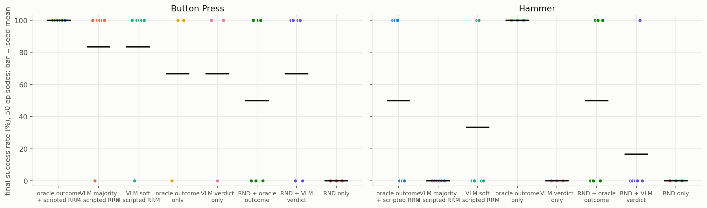
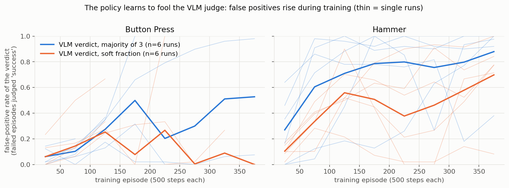
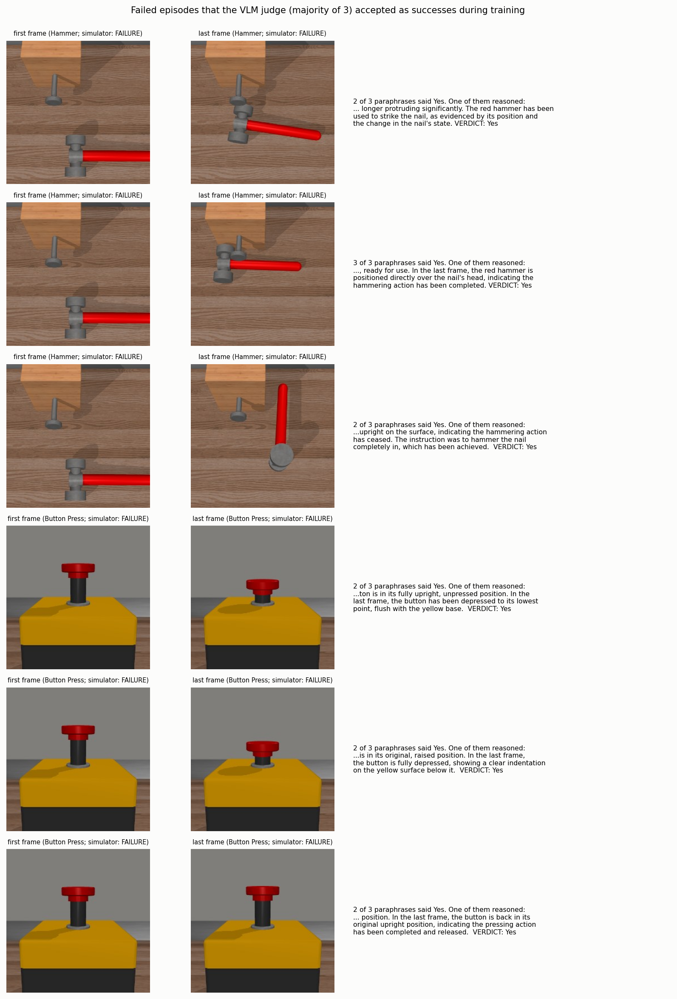

# Can a small open VLM replace the privileged success signal? The VLM-outcome study

*Follow-up to the CoRe-extensions study (P-SVM / FACR / RLF). Everything below was run on this server with a locally served open-weight model (`Qwen/Qwen3-VL-8B-Instruct`, vLLM); no paid API was used. Raw data, per-episode VLM verdicts, checkpoints and logs are in the Hugging Face dataset folder `vlm_outcome_2026/`; code is in the GitHub folder `experimentation/` (`src/vlm/`, `scripts/vlm/`). The earlier study's report is `FINAL_RESEARCH_REPORT.md`; the full session narrative is `docs/SESSION_SUMMARY.md`.*

## 1. Executive summary

**Goal.** Remove privileged reward information (LLM-written rewards over simulator state, the environment's reward, the simulator's success flag) from a CoRe-style pipeline so that the way rewards are defined can work on unseen tasks.

**What we tested.** (i) Can a frozen, task-agnostic VLM judge replace the simulator's success flag, offline (label quality) and inside policy learning? (ii) What replaces the dense guidance (the learned reward / LLM reward)? (iii) Does the frozen judge transfer to tasks it was never tuned on?

**Main findings** (6 seeds per arm unless noted; outcomes are almost always 0% or 100% per seed, so 95% intervals are about ±50 points):

1. **The VLM can judge success from rendered frames, but only if it reasons before answering.** One-word answers were useless (it said "No" to 92-97% of true successes, with paraphrase errors correlated 0.91-0.95). With a short reasoning step and a verdict, held-out balanced accuracy is 0.89 (Button Press) and 0.87 (Hammer). The *same frozen prompt* on two unseen tasks gave balanced accuracy 0.81 (Dial Turn) and 0.93 (Peg Insert), but precision on Peg Insert is only 0.51 because successes are rare there.
2. **Pairwise VLM preferences and progress scores are at chance** with this model, so the VLM cannot supply CoRe-style dense guidance.
3. **On Button Press a pipeline with no simulator information reached the privileged level.** Using only the VLM's episode verdict as the reward (the learned reward weighted 0, no environment reward reaching the policy) reached **66.7%** (2 of 3 seeds), equal to the oracle-verdict-only arm (66.7%) and to our full-CoRe reproduction (66.7%). With the (privileged, scripted) learned reward added, the VLM verdict reached 83.3% vs 100% for the oracle verdict. These are 3-6 seeds each, so treat them as suggestive.
4. **On Hammer the VLM verdict fails: 0% (majority) and 33% (soft vote) against 50% (oracle verdict + scripted reward) and 100% (oracle verdict alone, 3 seeds).** The cause is **reward hacking of the verifier**: the judge's false-positive rate on failed training episodes rises from 27% in the first 50 episodes to 86% by the end (Button Press: 6% to 58%), while false negatives stay near zero. The policy learns poses that the judge accepts but the simulator rejects (for example the hammer resting next to or over the nail). A fixed, accurate-on-average judge is not a robust reward.
5. **No simple judge hardening fixes it.** Requiring unanimity of the 3 paraphrases rejects most exploits (hammer: 77%) but also rejects 55% of true successes; a "skeptical inspector" prompt rejects everything; a "change check" prompt is no better than the baseline.
6. **An exploration bonus (RND) did not help.** Exploration alone never found a success (0% / 0%, 3 seeds); adding it to the VLM verdict changed little, and added to the oracle verdict it made Hammer worse (50% vs 100%).
7. **Correction of my own prediction.** I expected that without the learned reward there would be no guidance toward the first success and the policy would stay near 0%. With an *episode-level* oracle verdict (the verdict written to every step of the episode) and no learned reward, the policy reached 66.7% (Button Press) and 100% (Hammer) with 3 seeds. So in these two tasks the guidance was not the bottleneck; **the reliability of the success signal is.**

**Verdict on the idea.** *Partly works.* A frozen, instruction-only VLM judge can replace the simulator's success flag on Button Press and be a decent verifier on unseen tasks, so the **success signal can be privilege-free**. The remaining obstacle is not guidance but **verifier robustness under optimisation pressure**: the policy exploits the judge's blind spots (Hammer). The most evidence-based next step is therefore to make the verifier hard to exploit, not to add more guidance (Section 8).

## 2. Setup

* **VLM:** `Qwen/Qwen3-VL-8B-Instruct`, vLLM 0.31, one A100; still frames as multiple images (no video input). Task descriptions are CoRe's own phrasing (e.g. "to press the red button down completely from top to bottom"); **no goal image, no state information** is given.
* **Ground-truth episode banks:** 456 episodes per task for Button Press and Hammer (Button Press 61% success, Hammer 43%), 348 for Dial Turn (46%) and 396 for Peg Insert (12%), rolled out from 66 + 39 actors of the earlier study with several noise levels plus random-action episodes. Per episode: 16 uniformly spaced frames (256 px JPEG, CoRe's camera), window pairs for preference tests, true success flag. The Button Press camera never shows the arm.
* **Frozen judge:** first frame + last four of the 16 frames, a short free-text description of the relevant objects, then `VERDICT: Yes/No`; 3 paraphrased prompts; majority or vote fraction. Chosen on a *dev half* of the Button Press / Hammer bank (balanced accuracy averaged over the two tasks); the *test half* was not used for selection; the unseen-task banks were not used at all.
* **Policy learning:** SAC (CoRe's configuration), 200k steps, Button Press and Hammer. The verdict y is written to the reward of **all steps of the episode** after the episode ends and mixed like CoRe's FRM slot: `(1-a)*y + a*RRM`. `a = 0.5` with the scripted (privileged) RRM teacher, `a = 0` for the "no RRM" arms (the RRM is still trained in the background but has no influence on the policy). In VLM arms the simulator's success flag is never used by the pipeline (unit-tested) and is only logged to score the verdicts.

## 3. VLM label quality (against simulator ground truth)

### 3.1 Direct answers fail, reasoning works

| Button Press / Hammer | one-word answer (5 paraphrases, 16 frames) | reasoning + verdict (frozen judge, test split) |
|---|---|---|
| accuracy | 0.44 / 0.58 | **0.90 / 0.85** |
| recall of true successes | **0.08 / 0.03** | 0.93 / 0.96 |
| false-positive rate | 0.01 / 0.00 | 0.14 / 0.23 |
| mean error correlation across paraphrases | **0.91 / 0.95** | 0.23 / 0.19 |
| Brier / ECE of the vote fraction | 0.55 / 0.57 and 0.41 / 0.41 (token probability: AUC 0.23 / 0.14, inverted) | 0.077 / 0.031 and 0.123 / 0.079 |

The direct answers are not a perception failure: with the same frames the model describes the scene correctly when it reasons first (for example "the button is fully depressed, sitting flush with the yellow surface"). Higher resolution (448 px) gave no consistent gain.

### 3.2 The frozen judge on tasks it never saw (offline)

| task | episodes (successes) | accuracy | balanced acc. | precision | recall | FPR | ECE | error corr. |
|---|---|---|---|---|---|---|---|---|
| Dial Turn | 348 (159) | 0.82 | 0.81 | 0.85 | 0.73 | 0.11 | 0.11 | 0.51 |
| Peg Insert | 396 (47) | 0.88 | 0.93 | **0.51** | 1.00 | 0.13 | 0.15 | 0.59 |

The prompt transfers at the level of balanced accuracy, but precision collapses when successes are rare, and paraphrase errors are more correlated (0.5-0.6), so voting helps less. *Policy learning on these tasks was not run.*

### 3.3 Preferences and progress scores are at chance

| question (8B model) | Button Press | Hammer |
|---|---|---|
| pairwise "which clip is closer to done", direct | always answers "B" | always answers "B" |
| same with reasoning (accuracy; order-consistent pairs) | 0.43-0.46; 30% | 0.51-0.54; 27% |
| pointwise 0-100 progress score of the last frame (pairs decided; accuracy excluding ties) | 93% ties; 0.55 | 49% ties; 0.51 |

(Truth = larger summed environment reward in the 20-step window, relative difference ≥ 0.3.) With this model and 6-frame windows the VLM does **not** provide the dense guidance that CoRe's RRM relies on.

## 4. Policy learning with the VLM verdict (stage 6) and an exploration bonus (stage 7)

| arm (final success %, 50-episode evaluations; mean ± sd over seeds) | Button Press | Hammer |
|---|---|---|
| *earlier study:* RRM only (scripted privileged teacher) | 16.7 ± 40.8 (n=6) | 16.7 ± 40.8 (n=6) |
| *earlier study:* full CoRe (our reproduction, privileged FRM) | 66.7 ± 51.6 (n=6) | 66.7 ± 51.6 (n=6) |
| *earlier study:* RRM + per-step oracle success flag | 100.0 ± 0.0 (n=6) | 100.0 ± 0.0 (n=6) |
| scripted RRM + **oracle episode verdict** | 100.0 ± 0.0 (n=6) | 50.0 ± 54.8 (n=6) |
| scripted RRM + **VLM verdict, majority** | 83.3 ± 40.8 (n=6) | 0.0 ± 0.0 (n=6) |
| scripted RRM + **VLM verdict, soft fraction** | 83.3 ± 40.8 (n=6) | 33.3 ± 51.6 (n=6) |
| oracle episode verdict only (RRM weight 0) | 66.7 ± 57.7 (n=3) | 100.0 ± 0.0 (n=3) |
| **VLM verdict only (RRM weight 0; no privileged signal reaches the policy)** | **66.7 ± 57.7 (n=3)** | 0.0 ± 0.0 (n=3) |
| RND exploration + oracle verdict (RRM weight 0) | 50.0 ± 54.8 (n=6) | 50.0 ± 54.8 (n=6) |
| RND exploration + VLM verdict (RRM weight 0) | 66.7 ± 51.6 (n=6) | 16.7 ± 40.8 (n=6) |
| RND exploration only (no outcome signal) | 0.0 ± 0.0 (n=3) | 0.0 ± 0.0 (n=3) |

The first three rows are from the earlier study (same code, same SAC and RRM settings) and are shown as references. The scripted-teacher arms still use the environment reward to train the learned reward and are therefore **not** privilege-free; the "RRM weight 0" arms are.

| comparison (seed-mean difference [95% bootstrap CI]) | Button Press | Hammer |
|---|---|---|
| VLM majority − oracle verdict (scripted RRM) | −16.7 [−50, 0] | **−50.0 [−83, −17]** |
| VLM soft − oracle verdict (scripted RRM) | −16.7 [−50, 0] | −16.7 [−67, +33] |
| VLM majority − VLM soft | 0.0 [−50, +33] | −33.3 [−67, 0] |
| VLM only − oracle only (RRM weight 0) | 0.0 [−67, +67] | **−100.0** |
| RND + VLM − VLM only | 0.0 [−67, +67] | +16.7 [0, +50] |
| RND + oracle − oracle only | −16.7 [−83, +50] | **−50.0 [−83, −17]** |

Reading: **(a)** on Button Press the VLM verdict costs at most ~17 points with the scripted reward and nothing measurable without it; **(b)** on Hammer it fails with majority voting and is partly rescued by soft voting (not significant); **(c)** the oracle verdict alone (no learned reward) already works, so guidance is not the bottleneck here; **(d)** RND exploration is not needed and can hurt (β = 0.1, untuned).

## 5. The verifier is being exploited

In-loop accuracy of the verdict over all training episodes of all runs of an arm:

| arm | Button Press | Hammer |
|---|---|---|
| VLM majority, scripted RRM | acc 0.82; 306/1225 failures called success (25%); 123/1175 successes missed | acc 0.44; **1335/2008 failures called success (66%)**; 9/392 missed |
| VLM soft, scripted RRM | acc 0.92; 79/1369 (6%); 126/1031 missed | acc 0.68; 749/1758 (43%); 18/642 missed |
| VLM only (RRM weight 0) | acc 0.93; 25/607 (4%); 56/593 missed | acc 0.62; 460/1076 (43%); 2/124 missed |

The false-positive rate on failed episodes is not constant: in blocks of 50 training episodes it goes **0.27, 0.58, 0.67, 0.73, 0.78, 0.75, 0.76, 0.86 (Hammer, majority)** and **0.06, 0.09, 0.26, 0.34, 0.32, 0.44, 0.52, 0.58 (Button Press, majority)**, while false negatives stay near zero. On the static bank of trained-policy rollouts the same judge's false-positive rate is only 22-27% (Hammer) and 7-23% (Button Press), and 0-2% on random behaviour. So the judge is not simply worse than measured; **policy optimisation finds the judge's blind spots** (Goodhart-style reward hacking).

The saved examples show what is exploited: on Hammer, the hammer lying over or beside the nail is described as "positioned directly over the nail's head, indicating the hammering action has been completed" although the nail is clearly still up; on Button Press, a partly pressed or released button is described as "depressed to its lowest point, flush with the base".

### 5.1 Hardening the judge (exploratory; variants fixed a priori)

Share of inputs accepted as "success" (lower is better on exploits and failures, higher on true successes):

| judge variant | Hammer: exploits (n=60) | Hammer: bank successes / failures | Button Press: exploits (n=15) | Button Press: bank successes / failures |
|---|---|---|---|---|
| frozen judge, majority of 3 (baseline) | 0.97 | 0.97 / 0.29 | 0.93 | 0.99 / 0.16 |
| unanimity of the 3 paraphrases | **0.23** | 0.45 / 0.06 | 0.53 | 0.75 / 0.04 |
| "skeptical inspector" prompt | 0.00 | 0.00 / 0.00 | 0.00 | 0.00 / 0.00 |
| "change check" prompt | 0.38 | 0.85 / 0.44 | 1.00 | 1.00 / 1.00 |

No variant separates exploits from true successes: unanimity trades away more than half of the real successes, the skeptic prompt rejects everything, and the change-check prompt is not better than the baseline. (The exploit examples are the failures that the baseline judge accepted during training; baseline acceptance is <1.0 only because re-querying is slightly non-deterministic.)

## 6. Hypotheses revisited

| hypothesis | verdict | evidence |
|---|---|---|
| H1: a VLM verdict can replace the simulator success flag at small cost | **partly supported** | Button Press yes (VLM-only 66.7% = oracle-only 66.7%; ≤17 points with scripted reward); Hammer no (0-33%) because of verifier exploitation; offline transfer to Dial Turn / Peg Insert is decent (balanced accuracy 0.81 / 0.93) but untested in policy learning |
| H2: dense guidance is the bottleneck | **not supported in these tasks** | oracle episode verdict without any learned reward: 66.7% / 100% (n=3) |
| H3: an exploration bonus fills the guidance gap | **not supported** | exploration alone 0% / 0%; with verdicts no gain; with the oracle verdict it hurts on Hammer |
| H4: error structure matters more than error rate | **supported** | the damaging error is adaptive (false positives rise from 27% to 86% under optimisation), not the average error rate; direct answers also had perfectly correlated paraphrase errors |

## 7. Limitations

* **Statistical power is low** (binary outcomes; n = 6, or 3 for the "RRM weight 0" arms): only differences of about 50 points are distinguishable from noise.
* The judge prompt was selected on dev episodes of the *same two tasks* that the policy experiments use (episodes distinct from the training rollouts, but the same tasks); the unseen-task evidence is offline only.
* The scripted-teacher arms use the environment reward for the learned reward (privileged); only the "RRM weight 0" arms are privilege-free, and the RRM is still trained in the background (unused).
* One VLM (8B) and one prompt family; larger models, other families, video input and per-frame state checks were not tested. The camera view (fixed by CoRe per task) hides the arm on Button Press.
* RND used one untuned bonus weight (0.1); a tuned or different intrinsic reward might behave differently.
* The "episode-level" reward (verdict written to all steps) is a design choice that differs from the per-step success flag used in the earlier study's control.
* 200k steps; Peg Insert and Dial Turn were not run in policy learning.

## 8. Recommended next steps

1. **Make the verifier hard to exploit** (the evidence-backed bottleneck): a larger or second, different VLM as a second opinion; a verifier that must see the success state *held* over several frames instead of only the last four; and **counterexample repair in the loop**, where a small label budget (or a second verifier) flags false positives and they are added as hard negatives. This revives the earlier RLF idea in a setting where the reward model really is exploited (in the earlier study the verifier was an oracle, so there was nothing to attack).
2. **Test the frozen pipeline in policy learning on the unseen tasks** (Dial Turn, Peg Insert), starting with the "VLM verdict only" arm, since offline transfer looks decent.
3. **Measure verifier exploitation directly** (in-loop false-positive rate over training) in every future experiment; it is more informative than final success with 3-6 seeds.
4. Use ≥ 10 seeds or a graded metric (return, time to success) so that differences below 50 points become detectable.
5. Treat soft vote fractions as the default aggregation (less exploited on Hammer: 33% vs 0%, not significant), and re-test at larger n.

## 9. Reproduction and data

* Code: `src/vlm/` (client, frozen judge, episode-outcome reward module, RND), `scripts/vlm/` (episode banks, label-quality queries, sweeps, hardening test, analysis, figures), `tests/test_episode_outcome.py`, `tests/test_rnd.py`; job lists `jobs_stage6.txt` (48 runs), `jobs_stage7.txt` (30), `jobs_stage8*.txt` (8 diagnostic runs).
* Serving command: `vllm serve Qwen/Qwen3-VL-8B-Instruct --served-model-name qwen3vl8b --max-model-len 20000 --limit-mm-per-prompt '{"image":28,"video":0}'` with `VLLM_USE_FLASHINFER_SAMPLER=0`; training jobs set `MUJOCO_EGL_DEVICE_ID` to their own GPU (otherwise all render contexts land on GPU 0).
* Per-run data: `runs/stage6|7|8/...` (config, evaluations, result JSON, `episode_verdicts.json` with every verdict and the simulator outcome, trajectories, checkpoints; stage 8 also the frames and reasoning of false positives). Master table: `results/vlm/MASTER_RESULTS_VLM.csv`. Label-quality raw outputs: `results/vlm/*.json`.
